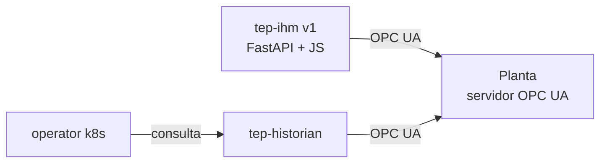
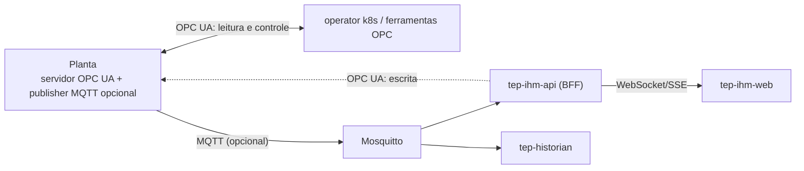

# spec-hefesto

> Hefesto, o deus grego da forja, construía autômatos para trabalhar ao seu lado.

Linha de pesquisa do [Green Cinnamon Labs](https://github.com/Green-Cinnamon-Labs) sobre aplicações de supervisão industrial: front em React, backend em Node, microsserviços em Python e deploy na AWS, construídos sobre a [planta compartilhada do Tennessee Eastman](https://github.com/Batchuka/spec-tennessee-eastman).

## O que sei hoje

- Quero uma prática de verdade com React e Node.
- O front do SCADA pode ser React. O backend do SCADA pode ser Node.
- O historian continua em Python, mas com mais rigor: quero aprender a fazer um microsserviço Python de forma adequada.
- Quero deployar tudo isso na AWS.

Isto muda conforme eu avanço.

## Repositórios

| Repositório                                                             | Papel                                                                                                 |
| ----------------------------------------------------------------------- | ----------------------------------------------------------------------------------------------------- |
| [`tep-ihm-web`](https://github.com/Green-Cinnamon-Labs/tep-ihm-web)     | IHM web em React                                                                                      |
| [`tep-ihm-api`](https://github.com/Green-Cinnamon-Labs/tep-ihm-api)     | Backend da IHM em Node                                                                                |
| [`tep-historian`](https://github.com/Green-Cinnamon-Labs/tep-historian) | Historiador em Python (também serve o [Gajeiro](https://github.com/Green-Cinnamon-Labs/spec-gajeiro)) |
| [`tep-ihm`](https://github.com/Green-Cinnamon-Labs/tep-ihm)             | IHM v1 (FastAPI e JS puro), referência durante o porte                                                |

As issues ficam em cada repositório e no [board](https://github.com/orgs/Green-Cinnamon-Labs/projects/12) (Linha = Hefesto). O jeito de trabalhar está em [`WORKFLOW.md`](WORKFLOW.md).

## Arquitetura

Decisões em [`docs/adr/`](docs/adr/). A arquitetura alvo da IHM está no [ADR 0001](docs/adr/0001-arquitetura-ihm.md).

Hoje, cada cliente abre sua própria sessão OPC UA com a planta:

Alvo:

## Livro

[`book/`](book/)
