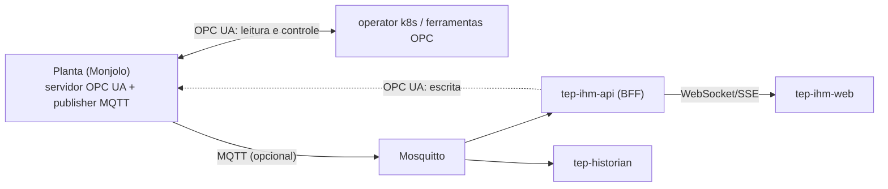

# 0001. Arquitetura alvo da IHM

Status: proposta · Issue: #3

## Contexto

Hoje a planta tem dois clientes OPC UA, cada um com seu jeito:

- o `tep-ihm` (v1) lê 41 XMEAS, 12 XMV e o flag de shutdown a cada 500 ms, desiste depois de 3 tentativas e, no mesmo `broadcast`, manda ao navegador, grava CSV e grava SQLite;
- o `tep-historian` lê a pasta `Signals` a cada 500 ms, guarda 1 h em memória e reconecta para sempre. Ele existe para ser consultado pelo operator k8s (`plant-supervisor`), não pela IHM.

Cada cliente abre uma sessão própria contra a planta, com política de falha própria. Um terceiro consumidor abriria uma terceira.

## Opções

- **(a) Node lê a planta direto** (`node-opcua`). É a v0. Cada consumidor novo abre mais uma sessão OPC UA.
- **(b) O historian repassa o stream.** Descartada: o historian não tem relação com a IHM. Ele serve ao operator.
- **(c) Broker MQTT no meio**, alimentado por quem lê a planta:
  - (c1) uma *bridge* externa, cliente OPC UA que publica no broker;
  - (c2) a própria planta publica, por um adaptador do framework (Monjolo).

## Decisão

(c2), com Mosquitto.

- A planta continua sendo um servidor OPC UA completo: é por ele que se lê o modelo de informação e se **controla** a simulação.
- O Monjolo ganha um **publisher MQTT opcional**, por configuração (porta de saída e adaptadores, *ports and adapters*, Cockburn, 2005). Publica só o que mudou.
- Se o publisher não conseguir conectar, **desiste** sem afetar o laço de simulação. O restabelecimento é um **comando no servidor OPC UA**.
- `tep-ihm-api` é um **BFF**: assina o broker e empurra ao navegador por WebSocket ou SSE (a escolha entre os dois fica para a issue do `tep-ihm-api`).
- Broker: **Mosquitto**, por ser o menor que cumpre o papel (53 valores a 2 Hz, uma planta).
- Sessões de captura e histórico ficam fora da IHM; a decisão sobre onde moram será tomada na issue do `tep-ihm-api`.

## Consequências

- A planta tem **uma** sessão OPC UA de leitura a menos: a IHM não lê por OPC UA.
- O Node ainda usa `node-opcua`, só para **escrever** (pausar, velocidade, distúrbios). A escrita fica como discussão arquitetural futura.
- Se o broker cair, ninguém republica sozinho: alguém precisa mandar o comando de reconexão ao servidor OPC UA. Aceito conscientemente; evita o backoff dentro do laço, mas o v1 mostrou o custo de "desistir" sem aviso, então a IHM deve exibir o estado "sem dado".
- O publisher roda dentro do código medido. O benchmark Rust×Python mede cada Monjolo **com e sem** ele.
- O contrato é neutro de linguagem: espaço de endereçamento OPC UA, tópicos e JSON Schema do payload. Valem para `monjolo-rust` e `monjolo-python`.
- Broker e `tep-ihm-api` sobem por manifesto no cluster. O `plant-supervisor` continua reconciliando só a planta.
- Mosquitto é nó único. Reavaliar se surgir necessidade de alta disponibilidade ou de muitos publicadores; como o contrato é MQTT padrão, a troca só mexe no manifesto.

## Fora deste ADR

- Contrato de interface obrigatório para qualquer historian que sirva ao operator (ingestão e consulta).
- Os quatro projetos (`monjolo-rust`, `monjolo-python`, `tep-rust`, `tep-python`) e o benchmark.
