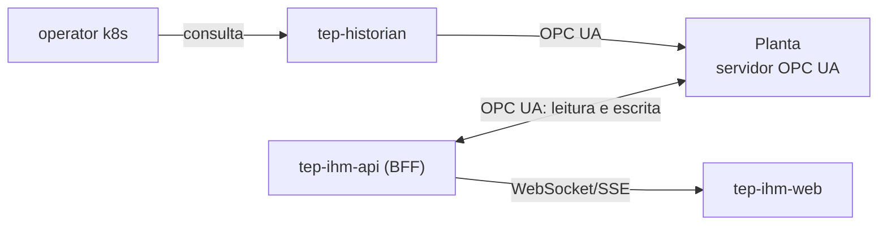

# 0002. IHM com conexão direta à planta

Status: aceita · Substitui o [ADR 0001](0001-arquitetura-ihm.md) · Issue: #3

## Contexto

O ADR 0001 decidiu pôr um broker MQTT (Mosquitto) entre a planta e a IHM, alimentado por um publisher opcional no framework da planta. A razão era que cada consumidor abre sua própria sessão OPC UA, com política de falha própria.

Pensando de novo, o broker resolve um problema que esta planta não tem. A planta é simulada, roda no mesmo cluster que os consumidores, e são poucos consumidores (a IHM e o historian). Nenhum problema com sessões extras foi observado. O cenário em que o MQTT ganha o seu lugar (muitos publicadores, enlaces intermitentes, sensores em campo) é o da **planta física**, que é outro projeto.

Além disso, o historian se conecta direto à fonte por natureza: ele puxa continuamente, e a completude do histórico não pode depender de um canal que "desiste" quando não conecta.

## Decisão

Conexão direta, a opção (a) do ADR 0001.

- A planta é um servidor OPC UA. Não há publisher MQTT nem broker.
- `tep-ihm-api` é um **BFF**: é cliente OPC UA (`node-opcua`), lê a planta e escreve nela (pausar, velocidade, distúrbios), e empurra o estado ao navegador por WebSocket ou SSE (a escolha fica para a issue do `tep-ihm-api`).
- `tep-historian` é cliente OPC UA direto e serve ao operator k8s. Não tem relação com a IHM.
- O broker MQTT fica como assunto de estudo para a planta física, com sensores.

## Consequências

- A planta tem duas sessões OPC UA, a do `tep-ihm-api` e a do `tep-historian`. Cada uma com a sua política de falha. Esta é a v0 do ADR 0001, e agora é escolha consciente.
- Quando um terceiro consumidor aparecer, ou a carga da planta com sessões for observável, o broker volta a ser candidato. O contrato com a IHM é o modelo de informação OPC UA, então o custo de adotar o broker depois é um adaptador.
- A reconexão com a planta é responsabilidade de cada cliente, e o `tep-ihm-api` não deve desistir depois de N tentativas como o v1 (a issue de stream do `tep-ihm-api` cobre isso).
- O contrato é neutro de linguagem: o espaço de endereçamento OPC UA, igual para `monjolo-rust` e `monjolo-python`.
- Sessões de captura e histórico: onde moram é decidido na issue do `tep-ihm-api`.

## Fora deste ADR

- Contrato de interface obrigatório para historians do operator (ingestão e consulta).
- Os quatro projetos (`monjolo-rust`, `monjolo-python`, `tep-rust`, `tep-python`) e o benchmark.
- MQTT na planta física.
